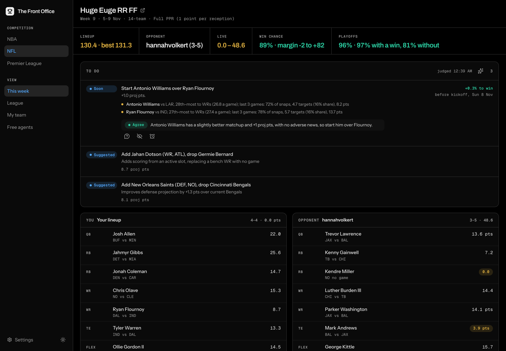
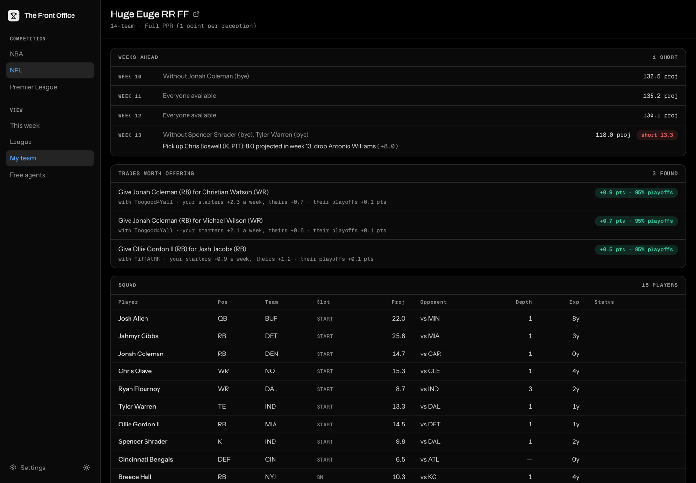
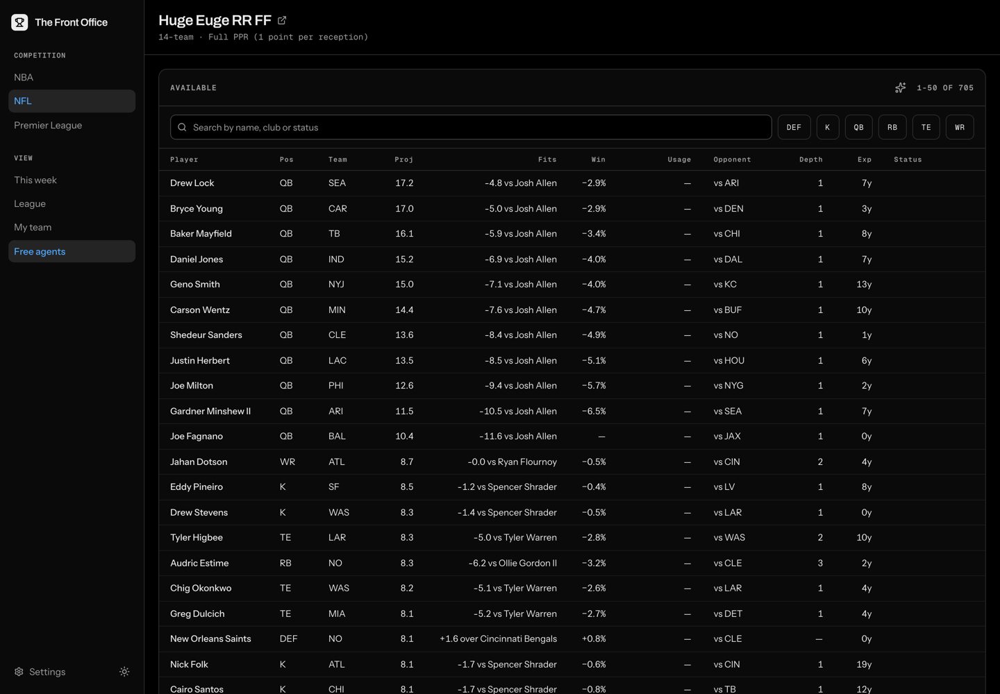
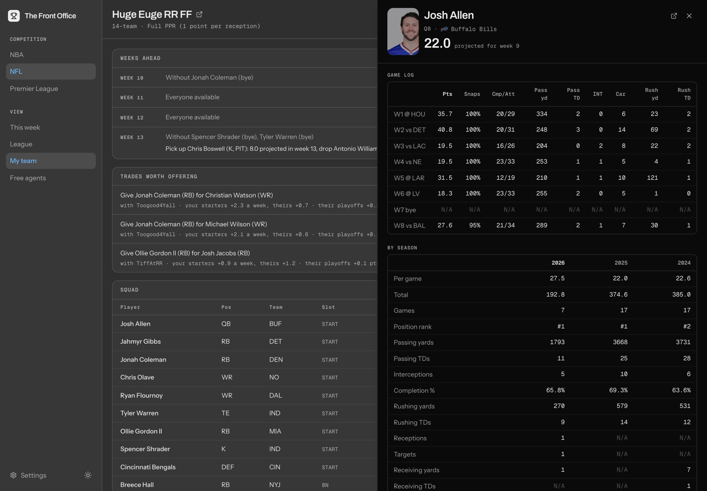
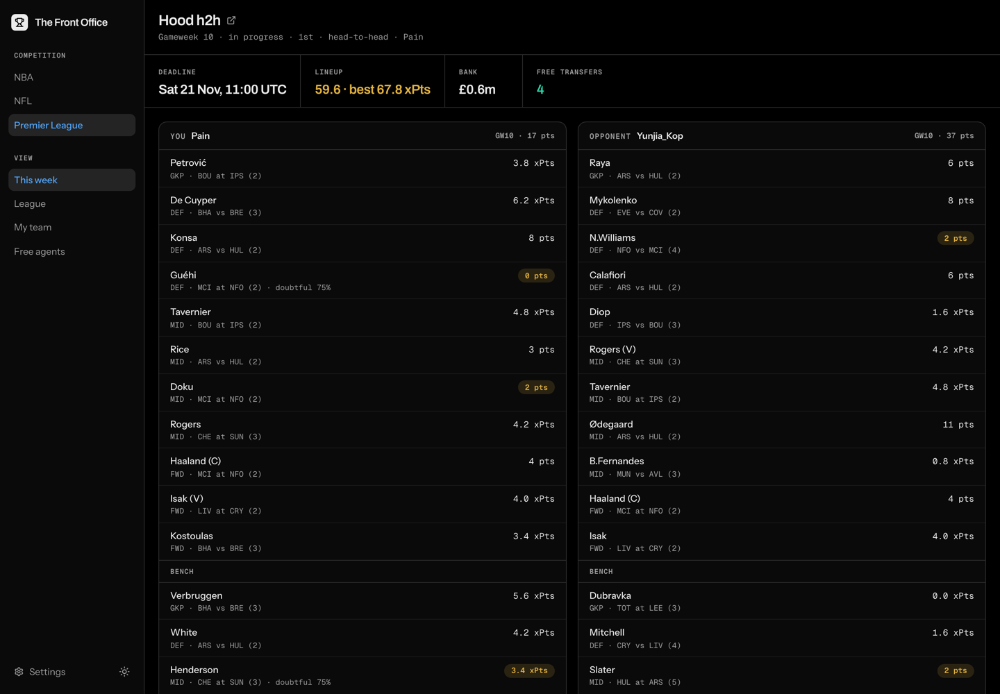

# The Front Office

[](https://github.com/abhishekbabu/thefrontoffice/actions/workflows/ci.yml)

An AI general manager for your fantasy teams. It reads your live league, real
stats and the fixtures ahead, and turns them into a to-do list for the week.
With a model key, it also judges each item and answers questions about any
player. It runs on your own machine against NFL on
[Sleeper](https://sleeper.com), the
[Premier League](https://fantasy.premierleague.com) and NBA on
[Yahoo](https://sports.yahoo.com/fantasy).



## Features

- **To-do list**: starters out or on bye, empty slots, bench swaps, next week's
  byes, free agents whose role just grew, and the trade deadline. Each item
  names the fix, who to drop and the deadline.
- **Win chance and playoff odds**: the week is simulated 10,000 times and the
  season 5,000 times, and every move shows what it does to both.
- **Weeks ahead and trades**: the next four weeks as your roster stands, and
  one-for-one trades that help both sides, ranked by your playoff chance.
- **Free agents**: ranked by projection, with how each fits your lineup, what
  he does to this week's chance, and any growing role ("snaps 34→76%").
- **Player pages**: role and matchup, ESPN news, injury status and a game log.
- **A model where you need it**: a verdict on each to-do item, a call on each
  free agent, and a **Why?** chat under any row. Without a key, none of it is
  shown.
- **Dismiss or snooze** any item. It comes back if its reason changes.
- **Light and dark mode**, several palettes, and a terminal CLI.

NFL has the deepest analysis. FPL and NBA share the week, team and league pages.

| | |
| --- | --- |
|  |  |
|  |  |

## Quick start

You need [`uv`](https://docs.astral.sh/uv/) 0.13.5 or newer (it fetches Python
3.15), [`just`](https://just.systems), and Node with
[`pnpm`](https://pnpm.io) (`corepack enable` gives you the version `web/` pins).
`brew bundle` installs uv and just; on Windows, use
`winget install --id=astral-sh.uv --id=Casey.Just -e`.

```sh
just install            # dependencies and git hooks
cp .env.template .env   # then add credentials (below)
just ui                 # http://localhost:8000, or the next free port
```

Add credentials in the app's **Settings** page or in `.env`. The page writes
`.env` and applies it without a restart.

- **NFL**: your Sleeper username, as `SLEEPER_USERNAME`.
- **Premier League**: the number in your points page URL,
  `fantasy.premierleague.com/entry/<THIS>/event/1`, as `FPL_ENTRY_ID`.
- **NBA**: a [Yahoo developer app](https://developer.yahoo.com/apps/), then
  `just yahoo-login` (see [Yahoo access](#yahoo-access)).
- **Analysis (optional)**: a free key from
  [Gemini](https://aistudio.google.com/app/apikey),
  [Groq](https://console.groq.com/keys) or
  [OpenRouter](https://openrouter.ai/settings/keys). With several, a call goes
  to the first that has quota.

> [!WARNING]
> `.env` and `.yahoofantasy` hold secrets. Never commit them. Don't copy
> `.yahoofantasy` to a second machine either: two machines sharing one refresh
> token sign each other out.

`just doctor` checks your setup: what each competition needs, what's set and
what's missing. It never prints a secret.

## Usage

| Command | What it does |
| --- | --- |
| `just ui` | Build the UI and serve it with the API. |
| `just run` | The interactive CLI. |
| `just doctor` | Check this machine's setup. |
| `just yahoo-login [--force]` | Authorize Yahoo in a browser. `--force` replaces the token. |
| `just backtest` | Score the win-chance simulation on finished weeks. |
| `just tune` | Search the simulation's range settings, holding out the last week. |

In the CLI: `/week`, `/roster`, `/scout`, `/trade <text>`, `/leagues`, `/help`.

### Yahoo access

The browser warns about the self-signed localhost certificate; that's expected.
If every Fantasy endpoint answers **403**, one of these is missing:

- Yahoo has to [approve the app](https://sports.yahoo.com/developer/access/)
  for Fantasy Sports API access. Personal use is an accepted category.
- **API Permissions → Fantasy Sports → Read** has to be saved *before* you
  authorize. A token keeps the grant it was issued with, so fix the permission,
  then run `just yahoo-login --force`.

## Configuration

Settings come from the environment or `.env`, and each is validated at startup.

| Variable | Default | |
| --- | --- | --- |
| `SLEEPER_USERNAME` | none | Enables NFL |
| `FPL_ENTRY_ID` | none | Enables FPL |
| `YAHOO_CLIENT_ID` / `YAHOO_CLIENT_SECRET` | none | Enables NBA |
| `YAHOO_REDIRECT_URI` | `https://localhost:8080` | Must match the Yahoo app |
| `YAHOO_MAX_WEEKLY_ADDS` | `3` | The NBA add budget |
| `GOOGLE_API_KEY` / `GROQ_API_KEY` / `OPENROUTER_API_KEY` | none | Model keys, tried in that order |
| `GROQ_ANALYSIS_MODEL` / `GROQ_PARSING_MODEL` | `openai/gpt-oss-120b` / `-20b` | |
| `OPENROUTER_ANALYSIS_MODEL` / `OPENROUTER_PARSING_MODEL` | `nvidia/nemotron-3.5-super-vl:free` | Any `:free` model with structured outputs |
| `PORT` | `8000` | Where `just ui` serves. If it's taken, the next free port is used. |
| `LOGFIRE_TOKEN` | none | Exports traces to [Logfire](https://logfire.pydantic.dev) |
| `LOGFIRE_CAPTURE_PROMPTS` | `false` | Also export prompt text, which carries your roster |
| `LOG_LEVEL` | `INFO` | |

`*_CACHE_DIR`, `ANSWER_CACHE_DIR` and `ITEM_STATE_DIR` move what the app keeps
on disk.

## How it works

- **Platforms.** Sleeper runs the NFL leagues and supplies stats for both NFL
  and NBA. FPL comes from its public API, NBA leagues from Yahoo, and news and
  injuries from ESPN. Every response is cached on disk, and transient failures
  are retried.
- **The to-do list is the app's, not the model's.** It is computed from league
  state before any model is asked. A model can agree, overrule or suggest, but
  it can't add, drop or restate an item.
- **Answers are typed.** Every model answer is a Pydantic model, never parsed
  prose. Answers are kept per input, so asking again with nothing changed
  makes no call.
- **Failover by quota.** Gemini, Groq and OpenRouter sit behind one port. A
  spent quota rests a provider and the call moves on to the next.

## Development

```sh
just check          # Python: lint, format, types, tests, coverage (what CI runs)
just check-web      # front end: API types, lint, types, tests, bundle budget
just api            # API on PORT, reloading
just web            # Vite with hot reload on :5173, proxying /api to PORT
just shots          # screenshot every view into web/.shots (--dark for dark mode)
just api-types      # regenerate the client's types after changing the API
just test-integration   # tests that call the live platforms (need credentials)
```

The backend is Python with FastAPI, organised as ports and adapters:

- `domain/` holds the models, ports and errors;
- `application/` holds the use cases: the week, season, wire, trades and answers;
- `adapters/` holds the CLI, the API, each platform's client and one provider
  per competition;
- `bootstrap.py` is the only module that names a concrete class.

The front end in `web/` is React, Vite, TanStack Query and Tailwind. Its API
types are generated from the backend.

Architecture rules and conventions for contributors and coding agents are in
[`AGENTS.md`](AGENTS.md).
