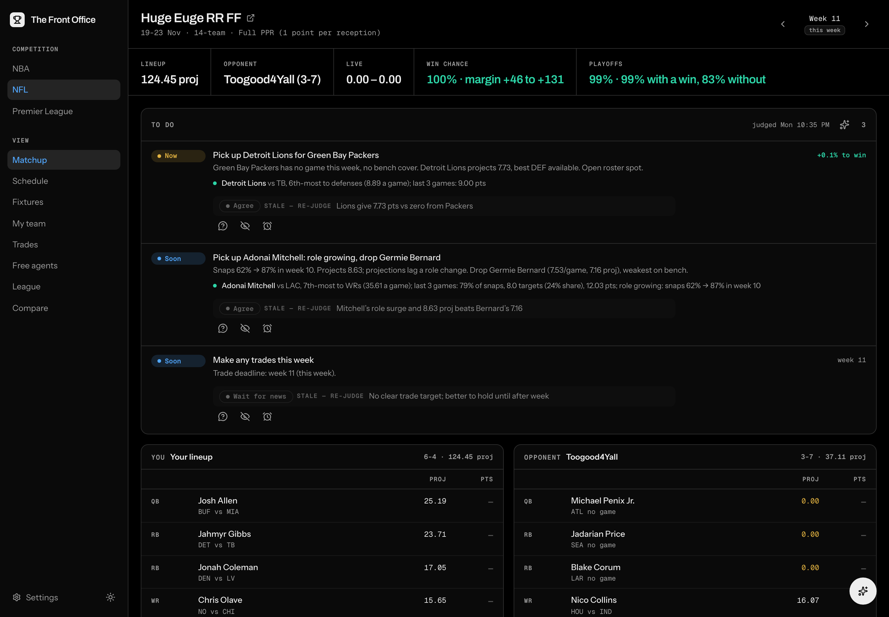
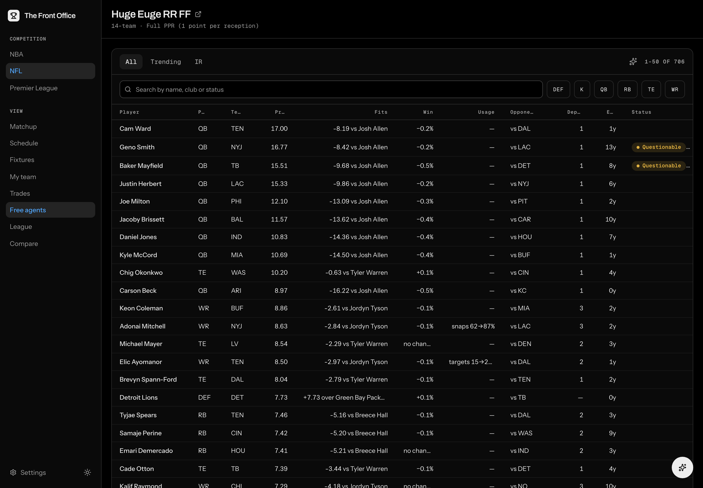
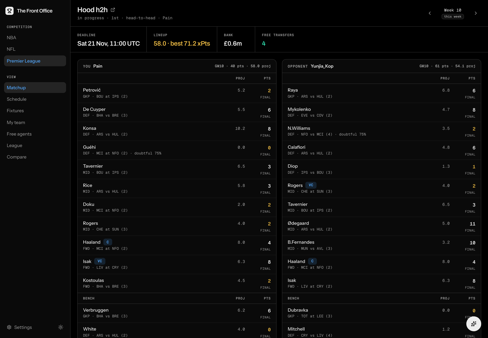

# The Front Office

[](https://github.com/abhishekbabu/thefrontoffice/actions/workflows/ci.yml)

An AI general manager for your fantasy teams. It reads your live league, real
stats and the schedule, and turns them into a to-do list for the week. It runs
on your machine against NFL on [Sleeper](https://sleeper.com), the
[Premier League](https://fantasy.premierleague.com) and NBA on
[Yahoo](https://sports.yahoo.com/fantasy).



## Features

- **To-do list**: starters out or on bye, empty slots, bench swaps, IR moves,
  pickups with a growing role, and the trade deadline. The best lineup starts
  whoever is worth most by that same value (form, projection, snaps), never a
  player on bye or ruled out; a bench swap is listed only at 1+ point of worth,
  stated for both ("Worth 12.87 vs Tyson's 11.49"). A role jump that came
  while a regular teammate sat is fill-in work, not a growing role, unless that
  teammate is ruled out of the coming week; a growing role must also be worth
  more than the starter he'd replace and the player he'd cost. Each item names the fix
  and who to drop: a bench player whose snap, target or carry share fell in each of
  his last 3 games first, one whose share rose in each, his club's depth-1 back or
  one of its top two in target share last, and between them the weakest for the
  rest of the season, his points a game beside his projection a game over the weeks
  left (that projection ±25% by his record against Sleeper's past ones, ±10% by his
  role's direction; season read
  beside a teammate who is back where his recent games were fill-in for him, or
  from his own games since a return from injury; ±10% for snaps
  steady at 50%+ or swinging by 20+ points, a climb to his most snaps not counting
  as a swing), never one the best lineup starts, one another item moves or drops,
  one you lock as untouchable in his drawer (nor is he traded or sold, in any
  competition), or a starter you set unless he trails the bench's pick by 3+ points
  a game on a role no better. A handcuff
  (the back next on the depth chart behind a running back you start) goes only
  once nobody ordinary is left, and the drop says whose he is. So does a stash,
  dropped before a handcuff: the back next behind any club's first back, whoever
  rosters him, where that back is healthy, played 60%+ of the snaps over his
  last three games, and scores more a game than your weakest RB or FLEX
  starter. An empty IR
  slot gets the best free agent on IR who is back before the playoffs (ESPN's
  estimate), projects 25+ points from then, and rates within a point a game of
  that weakest bench player, with the spot his claim takes until he moves to IR.
  An item that moves two players (a pickup and its drop, a swap) shows them
  side by side on the same rows: snap share, targets a game and target share
  over the last three games, points a game recent and season, projection and
  opponent. A bench player whose teammate is listed questionable reads as the
  start to make: "Start X over Y if Z sits" — only where his worth with Z out
  (his points a game without Z, given two such games, else his worth up a
  fifth) beats Y's; otherwise nothing is listed. A starter's "Keep X in" holds
  to the same rule against the best bench player for his slot. The trade-deadline item shows the
  Trades page's best offer and links there. The lineup's points column appears
  once the week's first game kicks off. Every lineup, bench, reserve and open-spot
  row is one fixed height on both teams: a line a row may lack (today's game, its
  kickoff, a score, a line of category figures) keeps its room blank, and long
  text truncates, so slot N on your side sits beside slot N on theirs.
- **Win chance and playoff odds**: the week is simulated 10,000 times and the
  season 5,000, each player's range centred on his projection. The week's chance
  is for the lineup the to-do list's swaps make; each of those swaps shows what
  undoing it would cost. Every move shows what it does to both, live on Sundays. The
  matchup header shows the score once a game kicks off, and playoff odds as
  "99% win / 83% loss".
- **Every week of the season**: page back to see what was played and forward to
  see the projected lineups. FPL gameweeks and NBA weeks work the same way; an NBA
  week also steps day by day (each side's slots, lines and score, projections ahead, bench players to start).
  An NBA week played shows its result, its final score and both rosters as
  they ended it (Yahoo's `roster;week=N`, cached 7 days), each player with his
  line in the league's categories or his fantasy points.
- **Trades**: near-even offers that start for you, one a row: give, get, the
  partner and why he might accept, and what each does to your regular season,
  your playoff weeks, your total and your playoff odds. Ranked by the odds, or
  once those are 80%+ by the total: points over every regular-season week left
  plus each playoff week weighed by the odds. None that lose points both before
  and in the playoffs; the ranked column is marked. Pricing notes are on hover.
  An NFL player is priced at his projection pulled halfway toward his recent
  scoring (at most 30% either way); after a role change, the games since count
  by their number, games / (games + 4), so two big games move his price a third
  as far as a settled role. A pickup most trades share is said once. NBA
  (Yahoo) offers one or two of yours for one of theirs, priced at a game's value in the league's scoring over the
  best free agent's, times his club's games left; only trades both sides gain on
  (10+ fantasy points or 0.1+ categories a week for them). A week is measured from
  each roster's daily lineups (the best who play each night, capped at the
  starting slots): fantasy points in a points league, or categories you expect to
  win in an "H2H Cat One" league, against the team you play each regular-season
  week and against the field in a playoff week. Each category's chance is normal on
  the two sides' totals: each player's game-to-game spread, plus spreads fitted to
  last season by `just calibrate-nba` (11.5% of games missed and expected, ±22–38%
  form a week by category, a line drawn toward the typical rostered player's where
  weeks bore it out; a percentage as makes over attempts). A week's chance is that of
  taking more than half, with the categories moving together through one fitted swing
  (a week a roster plays more lifts points, boards, threes and turnovers at once),
  so the season simulates on those chances. The
  trade deadline is read from the league's settings and shown; none past it. A
  player on an IL slot neither moves nor is moved for; a full roster taking two
  for one drops its least valuable player. Leagues counting every category in the
  table, or a best game only, are not searched. About 2s for the page on a cached
  10-team league.
- **Free agents**: best fit first, so a 1QB league's list does not open on
  quarterbacks. Fits is his value less that of the weakest starter in your best
  lineup he could replace, who on hover, both valued as the to-do list values a
  pickup and its drop (recent form and projection, fill-in work, snaps) and then
  by this week's matchup (±10%), or on
  form against a slumping starter; a starter on bye or ruled out counts as an empty slot. Kickers, defenses and
  players out past this week (IR, PUP, suspended) follow everyone else unless
  your K or DEF slot is empty this week, still best fit first under their
  position filter. The Win column shows only where a pickup moves this week's odds by half a
  point or more. With projection and rest-of-season points
  (next week through the fantasy final — the bracket's last week from
  `playoff_teams` and Sleeper's `playoff_round_type`, capped at week 18 — byes
  as zero; this week alone once none is left), snap and target share over the last 3 games, a
  role-jump trend, Sleeper's trending adds and an IR stash list, soonest back
  first by ESPN's estimated return. "Without" names a hurt or recently absent
  teammate his value hangs on (a regular at his position, or for a WR/TE the
  club's top target earner), with his points a game in the games that teammate
  missed or left under 30% of snaps against the games he played, on hover and
  in the drawer; once that teammate isn't ruled out, the figure beside him leads.
- **Player pages**: tabs for this week, the game log, past seasons, league
  history (draft pick, then each add, drop and trade, opening in full as in
  Activity) and linked news. An injured NFL player shows ESPN's injury, its
  estimated return week and the latest update; an injured NBA player shows the
  same with the return as a day, which his Status cell also gives on hover and
  the NBA model is told. An NFL player's first tab leads
  with his last 5 weeks (points, snap share, targets, carries), and his
  projected line lists only what his position is played for.
- **Compare**: up to four players side by side, added from any player page,
  a move in Activity, or by name (NFL, NBA and FPL). Figures sit under their heading (this week,
  projected line, this season), and the best of each comparable row is
  starred (fewest NBA turnovers, most of everything else). Searching a
  synced Yahoo league finds only the players the sync carried: every roster
  and the wire it read.
  The same comparison opens in a drawer from anything that weighs players
  against each other: a to-do item with two or more players (each marked In
  or Out), a trade idea or the to-do list's best trade (Give and Get), and a
  move in Activity or a player's history; a player in it opens with a Back
  link to it, and it can be carried over to this page. A measure over each
  player's latest games shares one row whatever his window ("82% (last 3)"
  beside "46% (last 2)").
- **Rosters**: any team's squad, yours by default, and the weeks ahead where
  somebody is out on a bye or hurt (one line when nobody is). NBA counts each of
  the next 4 weeks in games its daily lineups can start (active players playing
  each day that the lineup's slots seat) against the median week, naming
  regulars with 2 games or fewer, injured players with ESPN's return day,
  "heavy" weeks (most clubs play 4+), and a stream with more games in open slots than its drop
  at the to-do list's margin, one week each, none in a league without adds.
  A week the NBA has yet to finish scheduling (the Cup knockouts) is marked
  provisional: its count is a floor, so it is never short or light, streams
  nothing, and stays out of the median. FPL's weeks ahead are a fixture grid
  over the next 5 gameweeks: opponent, H/A and FPL's 1-5 difficulty, for only
  the players with a blank, a double, 3+ fixtures rated 4+, or a doubt; each
  gameweek a blank or double lands on the squad names who.
- **Schedule and Fixtures**: your season week by week, a future opponent with
  their record now. A week's real games grouped by kickoff, each naming your
  players and your opponent's in it, with the week's byes (FPL: blanks) on one
  line; a game opens to them. NBA builds your season from each week's Yahoo
  scoreboard: categories won-lost-tied, or points in a points league, with the
  playoff rounds named from the league's bracket.
- **League and Activity**: the table with PF, PA, FAAB left and waiver order,
  and every recent move in full.
- **AI, if you add a key**: a verdict on each to-do item and free agent, and an
  assistant that sees whatever's on screen. An agreement is a chip; only an
  overrule or a wait carries a reason.
- **Light and dark mode**, several palettes, and a terminal CLI.

NFL has the deepest analysis. FPL and NBA share the matchup, schedule, fixtures,
team and league pages. Each side of a matchup names its record now, from the
league's table (a past NBA week: as it stood then; FPL: head-to-head leagues only; a classic table keeps none). NBA averages are Yahoo's own, as Yahoo prints them (a rate
reads `.850`), one figure per stat on every page: in a category league, Free agents
and Rosters show every category the league scores over the last 30 days plus
`Value`, a game's worth across the categories (the to-do list's own figure, read on
its pool: both rosters of this week's matchup and the top of the wire; FG% and FT%
count by impact, the rate's distance from the pool's times attempts, so a 3-for-4
big doesn't outrank a 9-for-18 scorer), best first;
in a points league FPTS a game and PTS/REB/AST, most FPTS first. Free agents
instead open on what a pickup is worth this week: a game's value (or fantasy
points) times the games he can play — none while ruled out, those from ESPN's
return day once he is back, and a game-time decision's (GTD, DTD, Q) next game
at 0.8, the rate NFL's simulation gives a questionable player. A player out for
the week stays on the list, status and return shown, below everyone who plays;
a column click still sorts by that column. A game's value (`Value`, FPTS) leans on his
last five games where his minutes have moved: when his minutes a game over his last
five differ from the six-week window's by 3 or more, either way (or each of his last two is 3 above it), his line is pulled
from the usual reading (form beside projection) toward those five games' by
`games / (games + 5)`, halfway, the settling weight NFL's form uses
(`competitions/worth.settled`). With his minutes where they were, a big night
counts only its share of the average. The to-do list, streams, the weeks ahead,
the drawer and the free-agent order all read this one figure, though a category league's
to-do streams weigh each category by how close the forecast has it (4p(1−p), floor 0.1), keepers by the categories the roster ranks lowest in among the league's teams (the standings' season totals a game played; the week's pool without them), naming only those a keeper lifts from an average figure and those he costs (a stream's close categories alike). Free agents also show
`Min`, his minutes a game over his last five, with an arrow and the window's figure
where they moved (`37.7 ↑ (33.5)`), and `Rost`, the share of Yahoo leagues rostering
him and its change this week (`34% ↑12`), which is shown and not weighed. Lineup rows show
games left and Yahoo's PTS/REB/AST (FPTS in a points league); a week played shows
each category as a column. Position filters are PG/SG/SF/PF/C, plus G and F where
the league's lineup has them, each keeping anybody eligible there. The drawer has
the photo and whose roster he is on, then five tabs like NFL's. **This week**: games
left and against whom (`Thu 20 vs LAL · Sat 22 @ BOS`), what his next opponent gives
up to his position (points a game, or fantasy points in a points league, ranked
from Sleeper's box scores), `Cat value/g` (`Pts value/g` in a points league) and the week's worth,
minutes and usage (FGA + 0.44×FTA + TO) a game over his last five beside the last six weeks, Sleeper's
projected line, his last five games (value or FPTS, minutes, points), Yahoo's
averages over the season and the last 30 days (the latter only once it differs),
teammates out, injury, and his profile (experience, age, number, college).
**Game log**: every game in Sleeper's six-week window, oldest first, home or away,
with minutes, the counts, FG/FT made over tried and each game's value. **Seasons**,
**History** and **News** load only when opened (`GET …/players/{id}/tabs/{tab}`):
Sleeper's season totals for this season and the two before it a game at a time
(three requests shared by every player, cached 12 hours), every league move he was
part of (one Yahoo request for the season's transactions, cached an hour, also in
the browser sync), and ESPN's news for his club: naming him, or a trade, coaching change or regular out long. To-do items compare `Cat value/g` or `Pts value/g` (explained on hover), Yahoo's FPTS in a
points league, and in a category league the two categories dragging a player's
value most (`Weak in: FG% .380 · 2.9 TO`), which a drop's reason names too.
That costs one request per roster page (the roster's averages) plus, in a category
league, the matchup's rosters and the wire's first pages the summary reads anyway;
none more on Free agents (each wire page carries its averages), two per drawer
(season and last 30 days, cached 3 hours) plus the matchup's rosters and the wire's
first pages its value is scaled on (the summary's own reads), and the drawer's
player lookup carries his ownership. Sleeper's box scores still drive everything game by game: worth,
`Value`, the win chance, teammate splits and games left. An NBA league is read as Yahoo
scores it: a category league shows the categories, a points league its fantasy
points scored and projected, with the scout's free agents ranked by fantasy points
a game over their last 15 Sleeper box scores. The add budget is the league's own.
NBA's free agents are Yahoo's top 300 by season rank and top 100 by last week's,
taken in turn so the week's risers sit beside the season's best (16 requests
of 25 players: each ranking's first page cached for 30 minutes, the rest for 6 hours).
Each wire page carries every player's ownership and rostered share
(`out=ownership,percent_owned`, no extra request), so
a player on waivers reads `W 25 Nov` in Status ("Waivers · clears Wed 25 Nov" on hover
and in the drawer's owner, with your waiver order: "· you're #7"). Everything weighing his
week counts only his club's games from the day he clears — a claim processes overnight
and plays that night — and a pickup of him is a claim:
"Claim Brook Lopez (clears 25 Nov, 2 games), drop …" on the to-do list and in the
weeks ahead, until a week he will have cleared by.
NBA free agents get the same "Without" column, and every NBA drawer a Teammates
group: a club regular (28+ minutes a game over his last 15, or its top usage
player) who is out or day-to-day (Yahoo's status where his Yahoo row is on the
page, else ESPN's, with its return day) or sat one of the club's last 5 games,
with the player's PTS/REB/AST (and fantasy points in a points league) a game
without him and with him, from Sleeper's box scores; a game the regular played
under 12 minutes counts as missed, and both sides need 3 games. A regular with
fewer than 3 games this season counts by last season's minutes (28+ over 20+ games,
one Sleeper request shared by every player). Regulars who
missed the same games share one row naming them all. Where a regular at the
player's position (G, F or C) is out, ESPN dates his return within 7 days, and the
player has fewer than 3 games beside him but 3 or more without, "Without" warns
instead (`Duren back ~24 Nov`, "Jalen Duren (C, O) back ~24 Nov: 14 games without
him · 2 with"): his role may be the one the absence gave him. The scout's
roster and free-agent lines carry the same.
Each NBA lineup row, both teams, shows games left this week and a game's value
("3G · 41.5 fpts/g", or "3G · 22.1p 8.3r 4.0a" in categories). In the week being
played each row also says whether he plays today, in Pacific: "vs TOR today",
"@ BOS live", "vs TOR final", or "no game today", with that row dimmed. Sleeper
publishes the day; the hour of a game still to come is ESPN's daily scoreboard's
("vs TOR today 4:30 PM", in the viewer's own zone), left off if it will not load.
A schedule that will not load leaves the line off rather than claiming a day off.
Once his game today tips off, his row adds what he has done in it, from Yahoo's
day stats (refreshed every two minutes): his line in each category under his name,
or in a points league his fantasy points, live or final, beside his week. Left
off if Yahoo will not give it; the browser sync does not carry it.
An NFL row whose game is still to come says when it kicks off, from ESPN's
scoreboard, in the viewer's own zone ("today 5:15 PM", "Sun 1:00 PM"): Thursday's
players lock days before Monday's. An FPL row does the same from FPL's fixture
list, at his club's first match of the gameweek; one more than a week off is
dated ("Sat 6 Dec 3:00 PM"). An NBA player's
worth this week is that game's value (his recent run blended with Sleeper's
projection, or 3:1 his last 5 games where, his worst or best left out, 3 of 4 ran under 0.6× or over 1.4× its value (Slump, Hot: 24+ min, no injury), the season pulled ⅓ toward them, in fantasy points or across the scored categories, each counted in
its spread over the players read) × games left (none while ruled out, or from
ESPN's return date; none once out 4 straight with no firm return), ±10% for steady or swinging minutes. Sleeper's projection
joins Yahoo by name and club: a player Sleeper projects nothing (ruled out), a
match on another club, or a projection over 2.5× his recent run either way (with
a gap of 6 PTS, 4 REB, 3 AST or 1.5 3PTM a game) carries none, and he is read on
form alone. The to-do list adds
today's starts: a bench player whose game today is still to come, over a starter
whose slot he fits who has no game today or is ruled out of it, or who plays and
is a fifth worse a game. Nobody resting today is started, nobody whose game has
tipped off is moved, and without today's schedule there are no starts. Then up to
two streamers (from the wire's top 75 by season and top 50 by last week, five
requests) within the adds left, each a fifth more worth this week on the nights he fills an open slot, by at least 1.5 of its drop's games, and at least as
good a game as it, and a keeper taking one add, a fifth better a game for the season (at the share of games played after 2+ absences in the window, a night kept as rest not one), on 24+ min, never in a slump, cold shooting (FG%/FT% under 0.85× projected on volume), a falling role or an unbacked hot run, a runner-up within 5% for the same drop named on the item, behind every clean keeper if his news (club feed, or his ESPN page and story text, read for your roster and named keepers) has him in trade talk — one of yours in it is a note; a week under 10% or over 90% to win spends every add on keepers. No two adds share a drop, an open roster spot or IL slot (for a player out all week, naming who to drop when he is back) is used first, a keeper past the adds left is named as an alternative, one within 5% of the bar is called close, and a drop is a falling role, or a slump with trade talk, first — never from IL, the better half of the roster, minutes that are growing or a hot run.
While the NBA has yet to schedule days of a week (3+ days in a row with under 3
games, 1–20 Dec: the Cup knockouts, before eliminated clubs get games), the header
says "Schedule: not final", games left read "3+G", Fixtures carries a note naming
the days, to-do items and the win chance say "provisional", and the scout is told
the counts are a floor. It clears once Sleeper's schedule fills in.
Each item compares its players on games left, value a game, minutes, worth and
ESPN's return day. NBA free agents can be judged too: each line carries the
scout's figures and the weakest drop he clears by that margin, read over the
same players whoever is asked about.
The NBA matchup header carries a win chance too: what each side has on Yahoo's
scoreboard, plus every game its players have left, each drawn from one of their
last 15 box scores (Sleeper). On a night more of a roster plays than its
lineup holds, only the best count (all of today's starters' games where lineups
are set weekly); a player ruled out plays none until ESPN's return date. A points
league sums fantasy points (10,000 weeks, beside Yahoo's projection); a category
league plays 2,000 weeks, shows each category's chance in a Win column, and the
week goes to whoever wins more categories, level a tie. "High Score" leagues (only
each player's best game scores) get no chance, and the wire is not priced.

FPL's week is the gameweek being played until its last match ends ("final"),
then the next one: your last picks at each player's worth for it, against its
deadline. A player's worth for a gameweek is, per match: his points per match
over the last 5 finished gameweeks (a match he missed counts as nought, settled
with 5 matches of his season average) beside an outlook, each ×1.1 to ×0.8 by
fixture difficulty 2 to 5, plus a quarter from his underlying numbers (xG and xA
at his position's rates, his club's clean-sheet odds, saves, bonus, the
defensive-contribution points he has been earning). Clean-sheet odds are
Poisson, exp(−goals against), where goals against is the league's xG a side ×
the opponent's attack (its players' xG a match over the league's) × his club's
defence (its keepers' xGC a match over the league's) × the opponent's venue (the
league's home/away goal split); each club's rate is settled with 6 matches of
the league average, the venue with 40. A club with no match played yet, or a
season fixture list that will not load, falls back to odds by FPL difficulty
(50% at a 1 to 12% at a 5). The outlook is FPL's
`ep_next` where it differs from its form figure, else the underlying numbers
(this season `ep_next` repeats form). Matches sum, so a double counts both and
a blank is 0, × his chance of playing, ±10% for steady or rotated minutes
(60+ every match, or a 45-minute swing). One live feed per gameweek covers every
player, so form costs 5 cached requests. The eleven, the armband (never a player
under 75%; a vice beside him), the market's sort and its Worth column all use
it. Transfers use it summed over 4 gameweeks, a doubt recovering by half each
week. The to-do list: a bench player over a starter (+0.5, or any gain where the
starter is under 75% or blanks), the armband (+0.5), the first sub moved down
when he won't play, up to 3 transfers within the bank and free transfers (+1.5
over the 4, at most one −4 hit, only for a player in the best eleven and clearing
the hit by 2), and a chip within 3 gameweeks of expiring, naming a double or
blank for your clubs where the chip suits one. Free transfers follow the game's rules: one
from GW2, one more a gameweek up to five, none spent or earned in a Wildcard or
Free Hit week. Chips count per half (GW1/2-19, GW20-38), with the GW19 deadline
named while a first-half chip is unplayed. The scout prices a transfer at the
outgoing player's selling price (half of any rise since he was bought, from his
transfers), and Activity lists each member's transfers over the last three
gameweeks, one row per manager per gameweek.

An FPL player's drawer has four tabs: the week (fixture, xPts, form, his
position's underlying numbers, set pieces, and the market), his game log from
`element-summary` (newest first, in what his position scores: clean sheets and
saves for a keeper, defensive contribution outfield), the next 5 gameweeks'
fixtures, and his seasons. A flagged player gets the Injury group the other
sports show (Suspension, or Availability for a departure): status, what is hurt,
the return FPL's news gives ("Expected back 28 Nov" reads "~28 Nov · GW13") and
the news under the day it was set. Defensive contribution (2025/26 scoring: 10
CBIT for a defender, 12 CBIRT further forward) shows per 90 and in how many of
his matches reached it. The market shows this gameweek's price move, net
transfers and FPL's own price-change progress ("rise likely tonight" once its
overnight projection passes 100%). Any player is found by name, most worth first, then most owned.

A head-to-head FPL league's matchup header carries a win chance (10,000
gameweeks): each player's points from every match he played in the last 8
gameweeks, drawn once per match his club has left (twice in a double, none in a
blank), played with FPL's chance of playing or else how often he has played
lately; the captain counts twice on the same draw. Auto-subs follow the game's
rules: the reserve keeper only for the keeper, the outfield bench in order, each
one who plays coming on for the first starter who did not unless that would leave
fewer than 3 defenders, 2 midfielders or 1 forward, in which case he is passed
over for the next. Each bench player counts with the exact chance those rules
bring him on, given every player's chance of missing. A gameweek to come uses the last published picks, with each player's
matches scaled so their mean is his worth a match he plays. Classic leagues get
no chance.

| | |
| --- | --- |
|  |  |
|  |  |

## Quick start

You need [`uv`](https://docs.astral.sh/uv/) 0.13.5 or newer (it fetches Python
3.15), [`just`](https://just.systems), and Node with
[`pnpm`](https://pnpm.io) (`corepack enable` gives you the version `web/` pins).
`brew bundle` installs uv and just; on Windows, use
`winget install --id=astral-sh.uv --id=Casey.Just -e`.

```sh
just install            # dependencies and git hooks
cp .env.template .env   # then add credentials (below)
just ui                 # http://localhost:8000, or the next free port
```

Add credentials in the app's **Settings** page or in `.env`. The page writes
`.env` and applies it without a restart. It is laid out as Platforms (each with
its own status and how-to), AI, Appearance (this browser only) and Advanced.
Yahoo's card spells out only the `YAHOO_SOURCE` you pick: that way's note,
fields and how-to, with the other ways' fields under **Other methods**.

- **NFL**: your Sleeper username, as `SLEEPER_USERNAME`.
- **Premier League**: the number in your points page URL,
  `fantasy.premierleague.com/entry/<THIS>/event/1`, as `FPL_ENTRY_ID`.
- **NBA**: a [Yahoo developer app](https://developer.yahoo.com/apps/), then
  `just yahoo-login` (see [Yahoo access](#yahoo-access)). Until Yahoo approves
  the app, use your [session cookie](#yahoo-session-cookie) or the
  [browser sync](#yahoo-browser-sync) instead.
- **Analysis (optional)**: a free key from
  [Gemini](https://aistudio.google.com/app/apikey),
  [Groq](https://console.groq.com/keys) or
  [OpenRouter](https://openrouter.ai/settings/keys). With several, a call goes
  to the first that has quota.

> [!WARNING]
> `.env` and `.yahoofantasy` hold secrets (`.env` may hold your Yahoo session
> cookie). Never commit them. Don't copy
> `.yahoofantasy` to a second machine either: two machines sharing one refresh
> token sign each other out.

`just doctor` checks your setup: what each competition needs, what's set and
what's missing. It never prints a secret.

## Usage

| Command | What it does |
| --- | --- |
| `just ui` | Build the UI and serve it with the API. |
| `just run` | The interactive CLI. |
| `just doctor` | Check this machine's setup. |
| `just yahoo-login [--force]` | Authorize Yahoo in a browser. `--force` replaces the token. |
| `just backtest` | Score the win-chance simulation on finished weeks. |
| `just tune` | Search the simulation's range settings, holding out the last week. |
| `just calibrate-nba` | Fit NBA category odds on last season's Sleeper box scores; Brier-check them on this season. |

In the CLI: `/week`, `/roster`, `/scout`, `/trade <text>`, `/leagues`, `/help`.

### Yahoo access

The browser warns about the self-signed localhost certificate; that's expected.
If every Fantasy endpoint answers **403**, one of these is missing:

- Yahoo has to [approve the app](https://sports.yahoo.com/developer/access/)
  for Fantasy Sports API access. Personal use is an accepted category.
- **API Permissions → Fantasy Sports → Read** has to be saved *before* you
  authorize. A token keeps the grant it was issued with, so fix the permission,
  then run `just yahoo-login --force`.

### Yahoo session cookie

While Yahoo hasn't approved the app, the server can read Yahoo the way Yahoo's
own pages do, with your signed-in session. No syncing: each page fetches what it
needs.

1. On a Yahoo Fantasy page in Dia or Chrome, open DevTools → **Network**.
2. Click any request to `pub-api-ro.fantasysports.yahoo.com` → **Request
   Headers** → `cookie` → copy the value.
3. In **Settings**, paste it into `YAHOO_SESSION_COOKIE` and set `YAHOO_SOURCE`
   to `session` (no client id or secret needed).

**Settings → Platforms → NBA on Yahoo** shows how many leagues it read and when the
server last fetched with that cookie.
When Yahoo refuses it (you signed out, or the session timed out), NBA pages say
"Yahoo session expired" and send you to Settings; paste a fresh cookie and it
works again at once.

- **What it does.** The server GETs the same paths the browser sync plans from
  `https://pub-api-ro.fantasysports.yahoo.com/fantasy/v2/` with your cookie and
  browser-like headers, and caches each under the same key a sync would.
  Switching between `session` and `browser` keeps what either fetched. Before
  trusting a league list it checks your profile, since a signed-out session gets
  an empty list rather than a refusal.
- **How hard it asks.** Every request is yours, so the server keeps to a budget
  shared by the whole process: 2 requests a second after a burst of 4, at most 2
  in flight, and identical requests in flight at once share one. A 429, Yahoo's
  999 or a 5xx is retried with backoff, waiting at least as long as a
  `Retry-After` says (one asking for more than 20 seconds isn't retried). Three
  failures in a row pause every Yahoo request for 2 minutes (or for the
  `Retry-After`), and a refused cookie pauses them for 10, so a dead session
  doesn't hammer Yahoo. The same budget applies to `oauth`, on Yahoo's API host.
- **What it keeps, and for how long.** A settled week's scoreboard is kept for
  the season, last week's for 6 hours while stat corrections land, and weeks to
  come for 7 days. The week being played is kept 2 minutes while an NBA game can
  be on (09:00 to 01:00 Pacific, on a day Sleeper's schedule has games) and 30
  minutes otherwise. Settings are kept a day, teams, standings, rosters and the
  league list an hour. A copy past its time but within twice it is served at
  once and refreshed on one background thread, so a page never waits on Yahoo for
  something it read recently. Rivals' rosters and the deep wire are fetched only
  by the pages that show them; the week summary reads only the wire's first three pages. With 5 leagues, opening every NBA page costs about
  200 requests cold, nothing within the same couple of minutes, and about 400 a
  day for 5 visits.
- **The cookie is a password.** It's stored in the local `.env` and grants read
  access to your Yahoo account until it expires. Settings and `just doctor`
  only report whether it's set; it's never logged, never sent to Logfire
  (`cookie` headers are redacted), and sent nowhere but Yahoo. The cache keeps a
  16-character digest of it, to tell whether the cookie Yahoo refused is still
  the one set. To revoke it, sign out of Yahoo.
- **Temporary.** This uses Yahoo's undocumented, read-only frontend API and may
  break without notice. Switch with `YAHOO_SOURCE`: `oauth` (Yahoo's API),
  `browser` (the bookmark below) or `session`.

### Yahoo browser sync

While Yahoo hasn't approved the app, read Yahoo the way Yahoo's own pages do.
Set `YAHOO_SOURCE=browser` (no client id or secret needed), then in
**Settings → Platforms → NBA on Yahoo → Sync bookmark**:

1. Drag **Sync Yahoo** to your bookmarks bar.
2. Open any Yahoo Fantasy Basketball page, signed in, and click the bookmark.
3. The first time, Chrome asks whether the page may reach devices on your local
   network. Allow it: that's how the page reaches the app on `127.0.0.1`.

A banner on the page shows progress and the result (`Synced 5 leagues`). Run it
again whenever you want fresh data; Settings shows when it last ran. The app
reads only the sync in this mode and never calls Yahoo, and a sync older than
30 days is refused as stale.

- **What it does.** The bookmark asks the app what to fetch, fetches it from
  `pub-api-ro.fantasysports.yahoo.com` (the read-only host Yahoo's frontend
  uses) with your Yahoo session, and posts the response bodies to
  `/api/platforms/yahoo/capture`. It repeats until nothing new is planned: league lists,
  then each league's settings, teams, standings, scoreboards and free agents, then
  rosters. Anything the app holds fresh by the TTLs above (a settled week,
  today's settings) is left out, and the bookmark fetches two at a time. A sync
  from before a page's data was planned (the NBA table, or the deeper NBA wire)
  shows "run the sync again" on that page rather than an empty one.
- **What leaves the browser.** Only response bodies. Your Yahoo cookies stay in
  the browser and are attached to Yahoo's requests alone; the app accepts no
  other field and stores nothing but the bodies.
- **Who can call it.** Only pages on `https://*.fantasysports.yahoo.com` may
  call the sync routes cross-origin (including Chrome's private-network
  preflight). Every other origin gets a 403. Posts are capped at 48 MB.
- **Temporary.** This uses Yahoo's undocumented frontend API. It's read-only and
  may break without notice. Switching back is `YAHOO_SOURCE=oauth`.
- The bookmark targets the app it was dragged from (`http://127.0.0.1:8000` by
  default). If you move the app to another port, drag it again.

## Configuration

Settings come from the environment or `.env`, and each is validated at startup.

| Variable | Default | |
| --- | --- | --- |
| `SLEEPER_USERNAME` | none | Enables NFL |
| `FPL_ENTRY_ID` | none | Enables FPL |
| `YAHOO_SOURCE` | `oauth` | `session` reads Yahoo with your [session cookie](#yahoo-session-cookie); `browser` from the [browser sync](#yahoo-browser-sync) |
| `YAHOO_SESSION_COOKIE` | none | Your Yahoo Cookie header, for `YAHOO_SOURCE=session`. Secret |
| `YAHOO_CLIENT_ID` / `YAHOO_CLIENT_SECRET` | none | Enables NBA, read through OAuth |
| `YAHOO_REDIRECT_URI` | `https://localhost:8080` | Must match the Yahoo app |
| `YAHOO_MAX_WEEKLY_ADDS` | `3` | The NBA add budget for a league whose Yahoo settings name none |
| `GOOGLE_API_KEY` / `GROQ_API_KEY` / `OPENROUTER_API_KEY` | none | Model keys, tried in that order |
| `GROQ_ANALYSIS_MODEL` / `GROQ_PARSING_MODEL` | `openai/gpt-oss-120b` / `-20b` | |
| `OPENROUTER_ANALYSIS_MODEL` / `OPENROUTER_PARSING_MODEL` | `nvidia/nemotron-3.5-super-vl:free` | Any `:free` model with structured outputs |
| `PORT` | `8000` | Where `just ui` serves. If it's taken, the next free port is used. |
| `LOGFIRE_TOKEN` | none | Exports traces to [Logfire](https://logfire.pydantic.dev) |
| `LOGFIRE_CAPTURE_PROMPTS` | `false` | Also export prompt text, which carries your roster |
| `LOG_LEVEL` | `INFO` | |

`*_CACHE_DIR`, `ANSWER_CACHE_DIR` and `ITEM_STATE_DIR` move what the app keeps
on disk. Each directory holds one SQLite database, `cache.sqlite3` (WAL, values as
compressed JSON). A directory still holding the JSON files of the cache before it
is adopted, not discarded: each file moves into the database, keeping its age, the
first time its key is read, so kept answers and dismissed items survive the
upgrade. A file whose key is never read again stays where it is; `just clean-data`
removes the platform caches whole.

## How it works

- **Platforms.** Sleeper runs the NFL leagues and supplies stats for both NFL
  and NBA. FPL comes from its public API, NBA leagues from Yahoo, and news and
  injuries from ESPN (joined to Sleeper by ESPN's id where Sleeper carries it,
  else by full name within a club; joined to Yahoo's NBA players by full name
  within a club alone, a name two players there share matching nobody). ESPN's
  NFL injury report keeps only each club's latest 25 entries, so a player Sleeper has ruled out whom it has
  dropped is looked up on his own: his ESPN id from Sleeper or his club's ESPN
  roster, then his latest injury entry. Every response is cached on disk, and transient failures
  are retried. Football projections and stat lines are priced by each league's
  own scoring settings, as the Sleeper app prices them.
- **The to-do list is the app's, not the model's.** It is computed from league
  state before any model is asked. A model can agree, overrule or suggest, but
  it can't add, drop or restate an item: a suggestion about a player an item
  already moves isn't shown.
- **Answers are typed.** Every model answer is a Pydantic model, never parsed
  prose. Answers are kept per input, so asking again with nothing changed
  makes no call.
- **Failover by quota.** Gemini, Groq and OpenRouter sit behind one port. A
  spent quota rests a provider and the call moves on to the next.

## Development

```sh
just check          # Python: lint, format, types, tests, coverage (what CI runs)
just check-web      # front end: API types, lint, types, tests, bundle budget
just api            # API on PORT, reloading
just web            # Vite with hot reload on :5173, proxying /api to PORT
just shots          # screenshot every view into web/.shots (--dark for dark mode)
just api-types      # regenerate the client's types after changing the API
just test-integration   # tests that call the live platforms (need credentials)
```

The backend is Python with FastAPI, organised as ports and adapters:

- `domain/` holds the models, ports and errors;
- `application/` holds the use cases: the week, season, wire, trades and answers;
- `adapters/` holds the CLI, the API, each platform's client and one provider
  per competition;
- `bootstrap.py` is the only module that names a concrete class.

The front end in `web/` is React, Vite, TanStack Query and Tailwind. Its API
types are generated from the backend. It is linted and type-checked by Oxlint (`web/.oxlintrc.json`)
in one pass, type-aware through `tsrs` (there is no separate `tsc` step): its correctness rules (the React Compiler's included),
the promise and `any` checks, landmines' and anti-slop's rules (the latter vendored
in `web/lint/anti-slop/`), and the app's own in `web/lint/` (semantic colors
only, no native `title` tooltips). Tests answer the app's requests with MSW
(`web/src/test/server.ts`); a request no handler answers fails the test.

Architecture rules and conventions for contributors and coding agents are in
[`AGENTS.md`](AGENTS.md).
