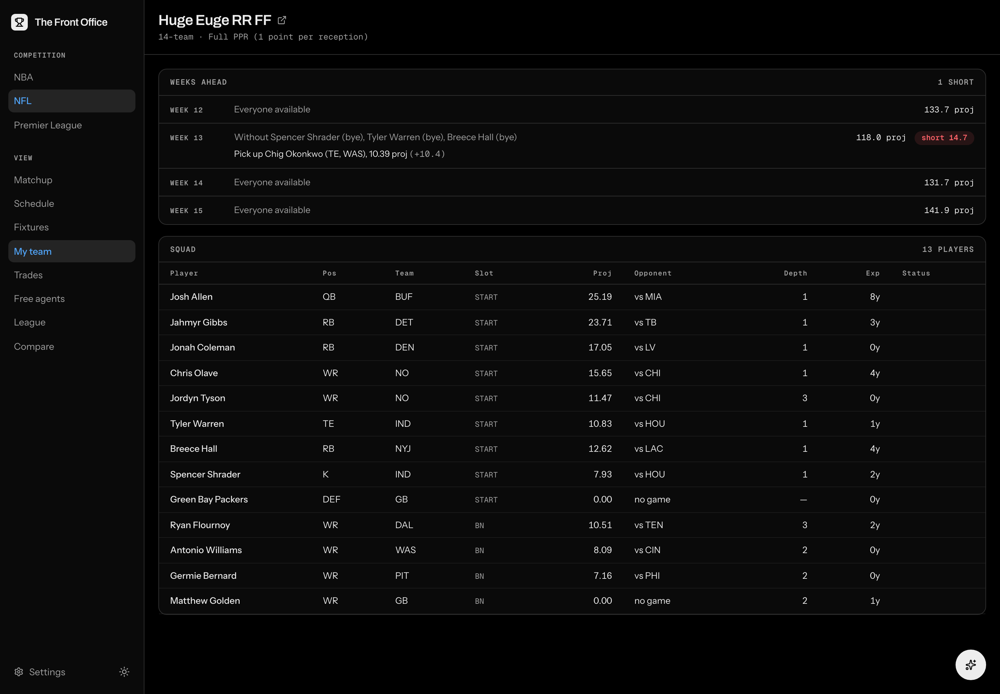
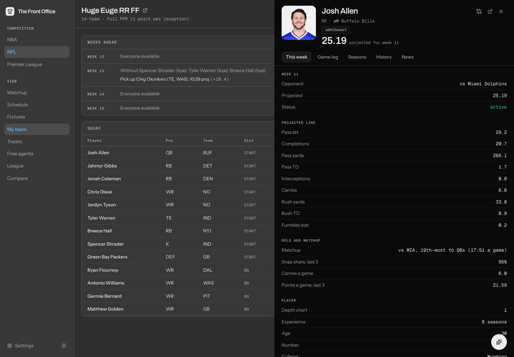

# The Front Office

[](https://github.com/abhishekbabu/thefrontoffice/actions/workflows/ci.yml)

An AI general manager for your fantasy teams. It reads your live league, real
stats and the schedule, and turns them into a to-do list for the week. It runs
on your machine against NFL on [Sleeper](https://sleeper.com), the
[Premier League](https://fantasy.premierleague.com) and NBA on
[Yahoo](https://sports.yahoo.com/fantasy).


## Features

- **To-do list**: starters out or on bye, empty slots, bench swaps, IR moves,
  pickups with a growing role, and the trade deadline. The best lineup starts
  whoever is worth most by that same value (form, projection, snaps), never a
  player on bye or ruled out; a bench swap is listed only at 1+ point of worth,
  stated for both ("Worth 12.87 vs Tyson's 11.49"). A role jump that came
  while a regular teammate sat is fill-in work, not a growing role, unless that
  teammate is ruled out of the coming week; a growing role must also be worth
  more than the starter he'd replace and the player he'd cost. Each item names the fix
  and who to drop: the weakest bench player by recent form and projection
  together (form read beside a teammate who is back where his recent games were
  fill-in for him; ±10% for snaps steady at 50%+ or swinging by 20+ points, a
  climb to his most snaps not counting as a swing),
  never one the best lineup starts or one just on bye. Pickup and drop are valued
  the same way. A handcuff
  (the back next on the depth chart behind a running back you start) goes only
  once nobody ordinary is left, and the drop says whose he is. So does a stash,
  dropped before a handcuff: the back next behind any club's first back, whoever
  rosters him, where that back is healthy, played 60%+ of the snaps over his
  last three games, and scores more a game than your weakest RB or FLEX
  starter. An empty IR
  slot gets the best free agent on IR who is back before the playoffs (ESPN's
  estimate), projects 25+ points from then, and rates within a point a game of
  that weakest bench player, with the spot his claim takes until he moves to IR.
  An item that moves two players (a pickup and its drop, a swap) shows them
  side by side on the same rows: snap share, targets a game and target share
  over the last three games, points a game recent and season, projection and
  opponent. A bench player whose teammate is listed questionable reads as the
  start to make: "Start X over Y if Z sits" — only where his worth with Z out
  (his points a game without Z, given two such games, else his worth up a
  fifth) beats Y's; otherwise nothing is listed. A starter's "Keep X in" holds
  to the same rule against the best bench player for his slot. The trade-deadline item shows the
  Trades page's best offer and links there. The lineup's points column appears
  once the week's first game kicks off.
- **Win chance and playoff odds**: the week is simulated 10,000 times and the
  season 5,000, each player's range centred on his projection. The week's chance
  is for the lineup the to-do list's swaps make; each of those swaps shows what
  undoing it would cost. Every move shows what it does to both, live on Sundays. The
  matchup header shows the score once a game kicks off, and playoff odds as
  "99% win / 83% loss".
- **Every week of the season**: page back to see what was played and forward to
  see the projected lineups. FPL gameweeks and NBA category weeks work the same way.
- **Trades**: near-even offers that start for you, one a row: give, get, the
  partner and why he might accept, and what each does to your regular season,
  your playoff weeks, your total and your playoff odds. Ranked by the odds, or
  once those are 80%+ by the total: points over every regular-season week left
  plus each playoff week weighed by the odds. None that lose points both before
  and in the playoffs; the ranked column is marked. Pricing notes are on hover;
  a pickup most trades share is said once.
- **Free agents**: best fit first, so a 1QB league's list does not open on
  quarterbacks. Fits is his value less that of the weakest starter in your best
  lineup he could replace, who on hover, both valued as the to-do list values a
  pickup and its drop (recent form and projection, fill-in work, snaps); a
  starter on bye or ruled out counts as an empty slot. Kickers, defenses and
  players out past this week (IR, PUP, suspended) follow everyone else unless
  your K or DEF slot is empty this week, still best fit first under their
  position filter. The Win column shows only where a pickup moves this week's odds by half a
  point or more. With projection and rest-of-season points
  (next week through the fantasy final — the bracket's last week from
  `playoff_teams` and Sleeper's `playoff_round_type`, capped at week 18 — byes
  as zero; this week alone once none is left), snap and target share over the last 3 games, a
  role-jump trend, Sleeper's trending adds and an IR stash list, soonest back
  first by ESPN's estimated return. "Without" names a hurt or recently absent
  teammate his value hangs on (a regular at his position, or for a WR/TE the
  club's top target earner), with his points a game in the games that teammate
  missed or left under 30% of snaps against the games he played, on hover and
  in the drawer; once that teammate isn't ruled out, the figure beside him leads.
- **Player pages**: tabs for this week, the game log, past seasons, league
  history (draft pick, then each add, drop and trade, opening in full as in
  Activity) and linked news. An injured NFL player shows ESPN's injury, its
  estimated return week and the latest update. An NFL player's first tab leads
  with his last 5 weeks (points, snap share, targets, carries), and his
  projected line lists only what his position is played for.
- **Compare**: up to four players side by side, added from any player page,
  a move in Activity, or by name. Figures sit under their heading (this week,
  projected line, this season), and the best of each comparable row is
  starred.
- **Rosters**: any team's squad, yours by default, and the weeks ahead where
  somebody is out on a bye or hurt (one line when nobody is).
- **Schedule and Fixtures**: your season week by week, a future opponent with
  their record now. A week's real games grouped by kickoff, each naming your
  players and your opponent's in it, with the week's byes (FPL: blanks) on one
  line; a game opens to them.
- **League and Activity**: the table with PF, PA, FAAB left and waiver order,
  and every recent move in full.
- **AI, if you add a key**: a verdict on each to-do item and free agent, and an
  assistant that sees whatever's on screen. An agreement is a chip; only an
  overrule or a wait carries a reason.
- **Light and dark mode**, several palettes, and a terminal CLI.

NFL has the deepest analysis. FPL and NBA share the matchup, schedule, fixtures,
team and league pages.

| | |
| --- | --- |
|  |  |
|  |  |

## Quick start

You need [`uv`](https://docs.astral.sh/uv/) 0.13.5 or newer (it fetches Python
3.15), [`just`](https://just.systems), and Node with
[`pnpm`](https://pnpm.io) (`corepack enable` gives you the version `web/` pins).
`brew bundle` installs uv and just; on Windows, use
`winget install --id=astral-sh.uv --id=Casey.Just -e`.

```sh
just install            # dependencies and git hooks
cp .env.template .env   # then add credentials (below)
just ui                 # http://localhost:8000, or the next free port
```

Add credentials in the app's **Settings** page or in `.env`. The page writes
`.env` and applies it without a restart.

- **NFL**: your Sleeper username, as `SLEEPER_USERNAME`.
- **Premier League**: the number in your points page URL,
  `fantasy.premierleague.com/entry/<THIS>/event/1`, as `FPL_ENTRY_ID`.
- **NBA**: a [Yahoo developer app](https://developer.yahoo.com/apps/), then
  `just yahoo-login` (see [Yahoo access](#yahoo-access)). Until Yahoo approves
  the app, use the [browser sync](#yahoo-browser-sync) instead.
- **Analysis (optional)**: a free key from
  [Gemini](https://aistudio.google.com/app/apikey),
  [Groq](https://console.groq.com/keys) or
  [OpenRouter](https://openrouter.ai/settings/keys). With several, a call goes
  to the first that has quota.

> [!WARNING]
> `.env` and `.yahoofantasy` hold secrets. Never commit them. Don't copy
> `.yahoofantasy` to a second machine either: two machines sharing one refresh
> token sign each other out.

`just doctor` checks your setup: what each competition needs, what's set and
what's missing. It never prints a secret.

## Usage

| Command | What it does |
| --- | --- |
| `just ui` | Build the UI and serve it with the API. |
| `just run` | The interactive CLI. |
| `just doctor` | Check this machine's setup. |
| `just yahoo-login [--force]` | Authorize Yahoo in a browser. `--force` replaces the token. |
| `just backtest` | Score the win-chance simulation on finished weeks. |
| `just tune` | Search the simulation's range settings, holding out the last week. |

In the CLI: `/week`, `/roster`, `/scout`, `/trade <text>`, `/leagues`, `/help`.

### Yahoo access

The browser warns about the self-signed localhost certificate; that's expected.
If every Fantasy endpoint answers **403**, one of these is missing:

- Yahoo has to [approve the app](https://sports.yahoo.com/developer/access/)
  for Fantasy Sports API access. Personal use is an accepted category.
- **API Permissions → Fantasy Sports → Read** has to be saved *before* you
  authorize. A token keeps the grant it was issued with, so fix the permission,
  then run `just yahoo-login --force`.

### Yahoo browser sync

While Yahoo hasn't approved the app, read Yahoo the way Yahoo's own pages do.
Set `YAHOO_SOURCE=browser` (no client id or secret needed), then in
**Settings → Yahoo sync**:

1. Drag **Sync Yahoo** to your bookmarks bar.
2. Open any Yahoo Fantasy Basketball page, signed in, and click the bookmark.
3. The first time, Chrome asks whether the page may reach devices on your local
   network. Allow it: that's how the page reaches the app on `127.0.0.1`.

A banner on the page shows progress and the result (`Synced 5 leagues`). Run it
again whenever you want fresh data; Settings shows when it last ran. The app
reads only the sync in this mode and never calls Yahoo, and a sync older than
30 days is refused as stale.

- **What it does.** The bookmark asks the app what to fetch, fetches it from
  `pub-api-ro.fantasysports.yahoo.com` (the read-only host Yahoo's frontend
  uses) with your Yahoo session, and posts the response bodies to
  `/api/yahoo/capture`. It repeats until nothing new is planned: league lists,
  then each league's settings, teams, scoreboards and free agents, then rosters.
- **What leaves the browser.** Only response bodies. Your Yahoo cookies stay in
  the browser and are attached to Yahoo's requests alone; the app accepts no
  other field and stores nothing but the bodies.
- **Who can call it.** Only pages on `https://*.fantasysports.yahoo.com` may
  call the sync routes cross-origin (including Chrome's private-network
  preflight). Every other origin gets a 403. Posts are capped at 48 MB.
- **Temporary.** This uses Yahoo's undocumented frontend API. It's read-only and
  may break without notice. Switching back is `YAHOO_SOURCE=oauth`.
- The bookmark targets the app it was dragged from (`http://127.0.0.1:8000` by
  default). If you move the app to another port, drag it again.

## Configuration

Settings come from the environment or `.env`, and each is validated at startup.

| Variable | Default | |
| --- | --- | --- |
| `SLEEPER_USERNAME` | none | Enables NFL |
| `FPL_ENTRY_ID` | none | Enables FPL |
| `YAHOO_SOURCE` | `oauth` | `browser` reads Yahoo from the [browser sync](#yahoo-browser-sync) |
| `YAHOO_CLIENT_ID` / `YAHOO_CLIENT_SECRET` | none | Enables NBA, read through OAuth |
| `YAHOO_REDIRECT_URI` | `https://localhost:8080` | Must match the Yahoo app |
| `YAHOO_MAX_WEEKLY_ADDS` | `3` | The NBA add budget |
| `GOOGLE_API_KEY` / `GROQ_API_KEY` / `OPENROUTER_API_KEY` | none | Model keys, tried in that order |
| `GROQ_ANALYSIS_MODEL` / `GROQ_PARSING_MODEL` | `openai/gpt-oss-120b` / `-20b` | |
| `OPENROUTER_ANALYSIS_MODEL` / `OPENROUTER_PARSING_MODEL` | `nvidia/nemotron-3.5-super-vl:free` | Any `:free` model with structured outputs |
| `PORT` | `8000` | Where `just ui` serves. If it's taken, the next free port is used. |
| `LOGFIRE_TOKEN` | none | Exports traces to [Logfire](https://logfire.pydantic.dev) |
| `LOGFIRE_CAPTURE_PROMPTS` | `false` | Also export prompt text, which carries your roster |
| `LOG_LEVEL` | `INFO` | |

`*_CACHE_DIR`, `ANSWER_CACHE_DIR` and `ITEM_STATE_DIR` move what the app keeps
on disk.

## How it works

- **Platforms.** Sleeper runs the NFL leagues and supplies stats for both NFL
  and NBA. FPL comes from its public API, NBA leagues from Yahoo, and news and
  injuries from ESPN (joined to Sleeper by ESPN's id where Sleeper carries it,
  else by full name within a club). ESPN's league-wide injury report keeps only
  each club's latest 25 entries, so a player Sleeper has ruled out whom it has
  dropped is looked up on his own: his ESPN id from Sleeper or his club's ESPN
  roster, then his latest injury entry. Every response is cached on disk, and transient failures
  are retried. Football projections and stat lines are priced by each league's
  own scoring settings, as the Sleeper app prices them.
- **The to-do list is the app's, not the model's.** It is computed from league
  state before any model is asked. A model can agree, overrule or suggest, but
  it can't add, drop or restate an item: a suggestion about a player an item
  already moves isn't shown.
- **Answers are typed.** Every model answer is a Pydantic model, never parsed
  prose. Answers are kept per input, so asking again with nothing changed
  makes no call.
- **Failover by quota.** Gemini, Groq and OpenRouter sit behind one port. A
  spent quota rests a provider and the call moves on to the next.

## Development

```sh
just check          # Python: lint, format, types, tests, coverage (what CI runs)
just check-web      # front end: API types, lint, types, tests, bundle budget
just api            # API on PORT, reloading
just web            # Vite with hot reload on :5173, proxying /api to PORT
just shots          # screenshot every view into web/.shots (--dark for dark mode)
just api-types      # regenerate the client's types after changing the API
just test-integration   # tests that call the live platforms (need credentials)
```

The backend is Python with FastAPI, organised as ports and adapters:

- `domain/` holds the models, ports and errors;
- `application/` holds the use cases: the week, season, wire, trades and answers;
- `adapters/` holds the CLI, the API, each platform's client and one provider
  per competition;
- `bootstrap.py` is the only module that names a concrete class.

The front end in `web/` is React, Vite, TanStack Query and Tailwind. Its API
types are generated from the backend.

Architecture rules and conventions for contributors and coding agents are in
[`AGENTS.md`](AGENTS.md).
